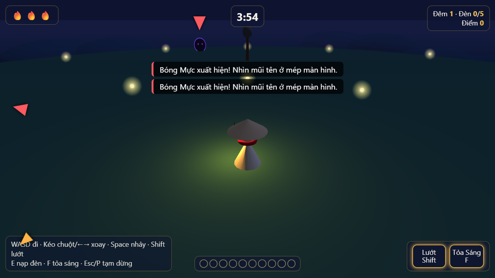

# Day 12 — AI SDLC: Đảo Đèn Lồng

> 🎬 **Video demo:** [docs/demo/demo.mp4](docs/demo/demo.mp4) hoặc đính kèm Release v1.0.0 *(tác giả bổ sung sau khi quay)*.


> **Cá nhân** (1 người / 1 MSSV) · Áp dụng SDLC cùng AI để xây một **game 3D** qua **4 phase**, từ yêu cầu ban đầu tới bản phát hành.
> **Lab board + trợ giảng:** **[Đảo Đèn Lồng Lab](https://claude.ai/artifact/Q1RYyv1dxjUczzCbd2ZnoW)**

---

## Tài liệu của lab

| File | Nội dung |
|---|---|
| [GUIDE.md](GUIDE.md) | Hướng dẫn làm lab: vòng làm việc mỗi phase, harness, kiểm chứng, token |
| [CHECKPOINTS.md](CHECKPOINTS.md) | Các mốc tự kiểm tra từ chuẩn bị đến nộp bài |
| [SUBMISSION.md](SUBMISSION.md) | Đặt tên repo, hạn nộp, tag, Release, video, checklist |
| [RULES.md](RULES.md) | Quy định: AI, trung thực về bằng chứng, bản quyền, bảo mật |
| [RUBRIC.md](RUBRIC.md) | Thang điểm chi tiết |

## Lab board

Yêu cầu dự án được phát hành tại **[Đảo Đèn Lồng Lab](https://claude.ai/artifact/Q1RYyv1dxjUczzCbd2ZnoW)**. Mỗi phase là một tab (tab chưa phát hành bị khóa), mỗi tab có trợ giảng AI riêng chỉ trả lời trong phạm vi phase đó. Trợ giảng cần đăng nhập claude.ai và dùng lượt Claude của bạn.

## Dự án

**Đảo Đèn Lồng**: game 3D góc nhìn thứ ba. Mây, người giữ đèn nhỏ tuổi, gom đom đóm để thắp lại các Đèn Lồng Lớn và né Bóng Mực trong sương đen.

- Không ràng buộc công nghệ; chạy được trên macOS hoặc Linux.
- Tuân theo **Test Contract** (chế độ headless) để được chấm tự động và so sánh với nhau.

| Phase | Bạn nhận | Nộp |
|---|---|---|
| 1 | **PRD-0** (mô tả tổng quát) + Test Contract | tag `phase-1` |
| 2 | **Ticket-02**, phát hành khi Phase 1 kết thúc | tag `phase-2` |
| 3 | **Ticket-03**, phát hành khi Phase 2 kết thúc | tag `phase-3` |
| 4 | **Ticket-04**, phát hành khi Phase 3 kết thúc | tag `phase-4` + Release `v1.0.0` |

Yêu cầu sẽ được bổ sung và có thể thay đổi giữa các phase, giống dự án thật.

### Lịch 4 giờ

Bài lab kéo dài **4 giờ**. Phase 1 và 2 khoảng **1 giờ**, Phase 3 khoảng **30 phút**, Phase 4 khoảng **1 giờ 30 phút**. Mỗi phase phát hành đúng mốc giờ. Phase mới xuất hiện trên lab board khi tới mốc.

| Mốc | Sự kiện | Hạn tag |
|---|---|---|
| 0h | Phát hành **Phase 1** (PRD-0), gồm cả phần chuẩn bị | `phase-1` trước mốc 1h |
| 1h | Phát hành **Phase 2** | `phase-2` trước mốc 2h |
| 2h | Phát hành **Phase 3** | `phase-3` trước mốc 2h30 |
| 2h30 | Phát hành **Phase 4** | `phase-4`, Release `v1.0.0` và video trước mốc 4h |
| 4h | Hết giờ lab, chốt bài | |

Hết giờ mỗi phase thì tag và chuyển sang phase tiếp theo, dù phase chưa hoàn hảo. Chỗ chưa xong ghi trung thực trong bằng chứng.

---

## Gợi ý SDLC (cách làm là của bạn)

Mỗi phase là một vòng nhỏ. Công cụ, thứ tự, định dạng tài liệu đều tự do; đây chỉ là gợi ý:

1. **Requirements:** biến yêu cầu thành tiêu chí nghiệm thu kiểm chứng được. Chỗ mơ hồ thì tự giả định và ghi lại.
2. **Plan:** nghĩ cách kiểm chứng **trước** khi để agent viết code.
3. **Build:** để agent viết, bạn điều phối và review.
4. **Verify:** chạy thật, kiểm tra hành vi thật. *Không có bằng chứng thì chưa xong*: "agent bảo chạy rồi" không phải bằng chứng.
5. **Evaluate:** cái gì đạt, AI sai ở đâu, harness (AGENTS.md, skill, hook) cần chỉnh gì.
6. **Release:** gắn tag.

## Ba điều cần nhớ

> Bạn được **tự do sáng tạo thêm** quanh phần lõi (nhân vật, cơ chế nhỏ, câu chuyện, hiệu ứng, âm thanh…). Sáng tạo gọn và không phá yêu cầu được tính điểm trong hạng mục F của [RUBRIC](RUBRIC.md); ghi mục "Sáng tạo của tôi" trong README của bạn.

- **Game tốt là game đúng yêu cầu của khách hàng**, không phải game phức tạp hay đẹp nhất. Làm đúng và chứng minh được là đúng trước, trau chuốt sau.
- **Cân nhắc kỹ quota token của bạn.** Đốt nhiều token không làm bài tốt hơn. Ngữ cảnh gọn, kế hoạch rõ, kiểm chứng sớm thường vừa rẻ vừa đúng hơn chạy agent liên tục.
- **Kiểm chứng là phần quan trọng nhất.** Bằng chứng (test, output headless, ảnh, số đo) đáng giá hơn lời mô tả.

---

## Bàn giao cuối cùng

Một **repo GitHub cá nhân, public**, gồm:

1. **Toàn bộ mã nguồn** của game qua 4 phase, tag `phase-1` … `phase-4`, Release `v1.0.0`.
2. **Video demo `.mp4` dưới 5 phút** (đính kèm Release `v1.0.0` hoặc `docs/demo/demo.mp4`, link ở đầu README): chơi thử và cho thấy bằng chứng game chạy đúng.
3. **Bằng chứng kiểm chứng** của từng phase (định dạng tự chọn).
4. **Harness AI đã dùng** (AGENTS.md / CLAUDE.md, skills, hooks, plugins…), giữ nguyên trong repo và lịch sử git.
5. **Ghi chép ngắn:** spec/giả định mỗi phase, nhật ký dùng AI (gồm token/chi phí ước tính), retro.

Không commit API key, token hay `.env`. Gửi link repo theo hướng dẫn của Coach.

## Đánh giá (100 điểm)

| Hạng mục | Điểm |
|---|---|
| Test tự động ẩn (headless, gồm kiểm tra lại phase trước) | 30 |
| Kiểm chứng & bằng chứng của bạn | 20 |
| Quy trình SDLC & harness AI | 15 |
| Evaluation & retro (gồm cách bạn dùng token) | 10 |
| Hiệu năng & ổn định | 10 |
| Chất lượng sản phẩm (đúng yêu cầu, chơi được) | 10 |
| Video demo | 5 |

## Quy định

- Dùng AI thoải mái; không sao chép repo của người khác.
- Bằng chứng phải thật: test luôn đạt hay output sửa tay là vi phạm.
- Nhân vật, bối cảnh là bản gốc của lab; asset bên ngoài chỉ dùng loại CC0/CC-BY/MIT hoặc tự tạo, ghi nguồn trong `CREDITS.md`.

---

# Đảo Đèn Lồng v1.0.0 — bài làm (Contract v1.3)



Game 3D góc nhìn thứ ba: **Mây**, người giữ đèn nhỏ tuổi, gom đom đóm để thắp lại các Đèn Lồng Lớn và giữ đảo sáng tới bình minh, né **Bóng Mực** trong sương đen. Lõi luật chơi (`src/sim.js`) thuần và tất định, dùng chung cho headless (chấm tự động) và client Three.js.

## Yêu cầu hệ thống

| | |
|---|---|
| Chạy game | Node.js **≥ 22** + trình duyệt có WebGL (Chrome, Edge, Firefox bản mới). Windows / macOS / Linux |
| Đo benchmark (`npm run bench`) | thêm Chrome/Edge/Chromium cài sẵn (tự tìm; hoặc đặt `DDL_BROWSER=<đường dẫn>`), có GPU/WebGL |
| Mạng | chỉ cần lúc `npm install` (tải three.js) |

## Cài đặt & chạy (3 lệnh)

```
git clone <repo> && cd <repo>
npm install        # build_cmd — cài three.js
npm start          # run_cmd  — mở http://localhost:8080
```

Không muốn cài npm? Tải `dao-den-long-v1.0.0.zip` ở Release v1.0.0, giải nén, chạy `node src/server.js`. Docker: `docker build -t ddl . && docker run -p 8080:8080 ddl`.

## Điều khiển (đổi được trong Cài đặt)

| Phím mặc định | Việc |
|---|---|
| W A S D | đi (theo hướng camera) |
| Kéo chuột / ← → | xoay camera |
| Space | nhảy |
| Shift | lướt 14 m/s × 0.2 s (hồi 1.5 s) |
| E | nạp đom đóm vào đèn / châm dầu (≤ 2 m) |
| F | Tỏa Sáng: tốn 3 đom đóm, choáng + đẩy lùi Bóng Mực, hồi 3 s |
| P hoặc Esc | tạm dừng (Tiếp tục / Chơi lại Đêm / Cài đặt / Về menu) |
| Enter | bắt đầu / qua màn |

**Cài đặt** (menu hoặc tạm dừng): âm lượng, độ nhạy chuột, bảng màu dễ phân biệt, **phụ đề / chỉ báo hình ảnh**, **giảm chuyển động**, **chữ lớn ×1.25**, **đổi phím** (báo trùng, "Khôi phục mặc định"). Mọi thứ được lưu.

## Luật (tóm tắt; số chuẩn ở `game.contract.json`)

- 3 Đêm: Đảo Bến (5 đèn, 240 s) → Đảo Cau (6 đèn, 270 s) → Đảo Chuông (7 đèn, 300 s). Thắp đèn cần 10 đom đóm (thắp lại 5). Đèn hao 1 dầu/s, tắt khi hết; châm dầu bằng đom đóm; Bóng Mực hút dầu đèn yếu (< 30).
- **Thắng** khi hết giờ mà Mây còn sống và ≥ 60 % đèn đang sáng; **thua** khi hết 3 Ngọn Lửa hoặc hết giờ thiếu đèn.
- Điểm: +5/đom đóm nạp, +100 thắp lần đầu, +40 thắp lại, +5 (+15 nếu bóng đang hút dầu) mỗi Bóng trúng Tỏa Sáng; thắng: mỗi đèn sáng +50+⌊dầu⌋, mỗi Lửa còn lại +50.

## Bảng xếp hạng

Sau màn **Bình Minh** (thắng Đêm 3) hoặc khi thua ở bất kỳ Đêm nào, nhập tên 3–12 ký tự (chữ, số, `_`; chữ Việt có dấu được) để lưu. Top 10, điểm giảm dần, bằng điểm thì ai đạt trước đứng trên. Lưu ở `data/leaderboard.json` (còn sau khi tắt/mở lại). Xem từ menu chính › *Bảng xếp hạng*. Xuất ra file:

```
npm start -- --export-leaderboard out.json     # hoặc: node src/server.js --export-leaderboard out.json
```

## Test, headless, bench, soak

```
npm test                                   # 68 test (~10 s): luật Phase 1–3, tất định, bench, soak, bảng xếp hạng, trợ năng
node src/headless.js --seed 1 --night 2 --ticks 600 --out out.jsonl [--scenario scenarios/charm.json] [--inputs scenarios/charm.inputs.json] [--snapshot-every 10]
node src/bench.js --seed 42 --duration 30 --out bench.json     # = npm run bench   (mở Chrome/Edge 1280×720, ~35 s)
node src/soak.js  --seed 7  --nights 10 --out soak.json        # = npm run soak    (< 5 s)
npm run package                            # tạo dist/dao-den-long-v1.0.0.zip
```

**Bench**: cửa sổ 1280×720 không toàn màn hình, **vsync tắt** bằng cờ Chromium `--disable-gpu-vsync --disable-frame-rate-limit` (`vsync_off` trong `bench.json` chỉ là `true` nếu số đo không giống bị khóa tần số quét). Cảnh chuẩn: Đêm 1, 200 Bóng Mực wander + 100 đom đóm, L1–L3 sáng, camera bay vòng R 30 m / Y 15 m / 15 s; 3 s khởi động rồi đo `--duration` giây. Bản web nên `peak_mem_mb` đo bằng tổng bộ nhớ các tiến trình trình duyệt (cận trên). Chi tiết giả định: [SPEC-PHASE4.md](SPEC-PHASE4.md) §7.

Kết quả tự đo của tác giả (laptop Intel UHD 11th-gen i5, Windows 11; **không phải** máy chấm): xem [bench.json](bench.json) và [soak.json](soak.json).

| Chỉ số | Ngưỡng | Đo được (bench.json) |
|---|---|---|
| avg_fps | ≥ 60 | 125.2 (lần khác: 100.4) |
| p1_low_fps | ≥ 30 | 57.8 (lần khác: 35.7) |
| load_ms | ≤ 10000 | 2426 |
| soak crashes / mem_end ≤ 1.2×mem_start | 0 / ≤ 1.2 | 0 / 50.9 ≤ 56.3 MB |

## Tài liệu kỹ thuật & bằng chứng

- [SPEC.md](SPEC.md) → [SPEC-PHASE2.md](SPEC-PHASE2.md) → [SPEC-PHASE3.md](SPEC-PHASE3.md) → [SPEC-PHASE4.md](SPEC-PHASE4.md): yêu cầu, AC, bảng giả định, truy vết tới test. [CHANGELOG.md](CHANGELOG.md), [CREDITS.md](CREDITS.md), [LICENSE](LICENSE) (MIT), [docs/RETRO.md](docs/RETRO.md).
- Bằng chứng: `docs/evidence/` (`phase3/*.jsonl`, `phase4/*.png|json|txt`, `determinism.txt`, `perf.txt`). Sinh từ lần chạy thật, không sửa tay.
- Harness AI: [AGENTS.md](AGENTS.md), `.claude/skills/headless-verify/`, `.claude/settings.json` (hook Stop chạy `npm test`), `.github/workflows/ci.yml`.

## Sáng tạo của tôi

Chỉ ở client (không đổi headless — được 6 test băm đầu ra bảo vệ): đảo/bầu trời đổi màu từ tím đen sang vàng cam theo số đèn đã thắp, vòng sáng an toàn quanh đèn, vòng sóng Tỏa Sáng, lá bay báo gió, nhạc nền + hiệu ứng tổng hợp WebAudio, đom đóm rơi nhấp nháy khi sắp hết hạn, "Ông Đăng" dẫn truyện trước mỗi Đêm, thanh dầu nổi trên đèn, đèn tắt xẹp + vết rách giấy (nhận diện không cần màu). Trong cảnh benchmark âm thanh/HUD/lá gió tắt để mọi bài đo cùng một cảnh.

## Nhật ký AI

Claude Code (Sonnet 5.5) viết lõi, headless, client, test, tài liệu; tôi đọc Ticket, chốt giả định và duyệt bằng chứng. Lỗi AI đã bắt được: (P2) tick hồi sinh vẫn cho Mây đi 0.1 m; test dùng bóng ở 20 m rồi tưởng nó đuổi (ngưỡng 12 m); assert viết vội luôn đúng; đo "21 600 tick" nhưng Mây chết sớm. (P4) `npm start --export-leaderboard out.json` bị npm nuốt cờ nên server khởi động thay vì xuất file — phát hiện nhờ chạy thật 3 cách gọi, thêm test; soak lần đầu cho mem_end/mem_start = 1.36 (thấy khi chạy, không phải rò rỉ: JIT) — đo lại sau khởi động JIT và ghi vào giả định B4-11; bench lần đầu p1_low 29.7 do rác GC mỗi khung — sửa. Token/chi phí: xem [docs/RETRO.md](docs/RETRO.md).
